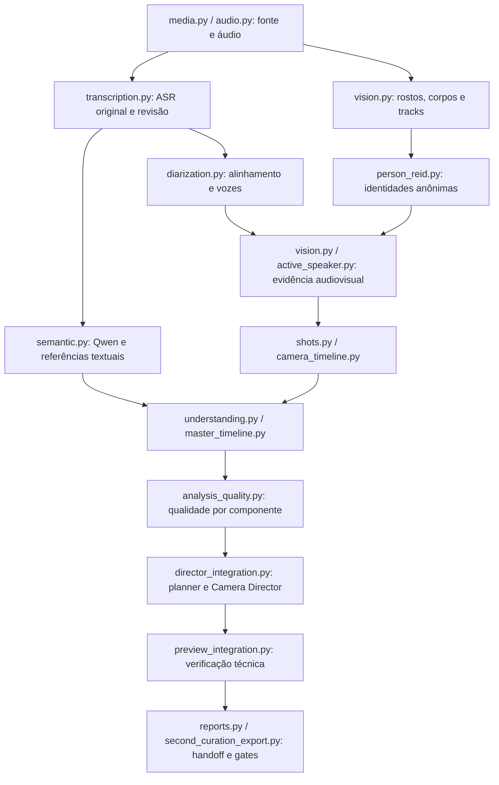

# L.D.PORTO — SOL V3, rodada de 13/10/2026

## Escopo e proveniência

Continuação da implementação atual, preservando a reestruturação de 12/10 e os arquivos já modificados pelo usuário. ZIPs históricos foram lidos como evidência; nenhum foi extraído sobre os fontes. Não houve commit, execução do orquestrador, pipeline completo em mídia real, alteração de credenciais ou aprovação/publicação automática. A regressão exercita cadeias completas em fixtures com produtores pesados mockados.

Branch inicial: `baseline/ldporto-20261012-prompt01`. HEAD: `2f4634f202f976c135c4bd28db590e289ce72156`. O inventário anterior distingue mudanças desta rodada das modificações preexistentes: [inventory_before.json](inventory_before.json).

Backup anterior aos edits SOL V3: `C:\Users\leone\Documentos\Meus Projetos\LDPORTO_SOLV3_BACKUP_20261013\working_sources_before_sol_v3.zip`, 529 arquivos, CRC e hashes de cada membro verificados; SHA-256 `70f452c7ca84d799991fbefcd2cfd2cd932bb0171e6be905bda743e3e51fcf81`. Registro: [backup.json](backup.json). Modelos, mídias originais e credenciais não foram copiados nesse backup de fontes.

O usuário restaurou o ZIP ANTES e autorizou explicitamente a instalação restrita de Ultralytics/torchvision e o peso oficial YOLO. Essa autorização específica permitiu a aquisição descrita abaixo. Os dois ZIPs, análises históricas e a fonte local foram preservados.

## Comparação dos pacotes históricos

| Evidência | ANTES | DEPOIS |
|---|---|---|
| ZIP | `SECOND_CURATION_PARTIAL_jNQXAC9IVRw_20261012_232326_642182_7f5d97.zip` | `SECOND_CURATION_PARTIAL_jNQXAC9IVRw_20261013_035536_877801_09f678.zip` |
| SHA-256 ZIP | `15f4fed54ad6279bb16d92b44e976bbec598cb5aea398c44e13edba565225dcf` | `843b5c05376f5c8a63845e225ad3069bd5778efd5afe888e1135ae63ecb7ac2d` |
| Validação pelo leitor atual | valid; referências resolvidas | valid; referências resolvidas |
| Semântica, total registrado | 289,360 s | 253,047 s |
| Chunk registrado | 149,187 s | 155,890 s |
| Revisão global registrada | 140,141 s | 97,094 s |
| Tokens de saída registrados | 2.113 | 1.731 |
| Chamadas registradas / cache | 2 / miss | 2 / miss |

Mesma fonte SHA-256 `e25bcad888afc039e27d316da0471ea08199ed2cf0f424cffd46d05a7902c998`, duração aproximadamente 19,014 s, 320×240, 15 FPS. O tempo semântico histórico caiu 12,55%; chunk aumentou 4,49% e global caiu 30,72%. A entrada da transcrição mudou de português para inglês: esses números **não isolam efeito do código ou do prompt compacto**. Ambos usavam `legacy_embedded_schema`. Registros detalhados: [runtime_historical_replay.json](runtime_historical_replay.json), [runtime_editorial_review.md](runtime_editorial_review.md).

O DEPOIS contém quatro candidatos de 2,14 / 7,72 / 1,08 / 1,86 s, abaixo do mínimo de 8 s; score máximo aproximadamente 0,404, abaixo de 0,5. Shortlist 0 é coerente com os gates. A rodada não força um corte elegível em uma fonte de 19 s. O agrupamento offline atual organiza quatro seções em uma, mantendo os quatro tópicos, cinco segmentos originais e suas referências; não transforma isso em uma história confirmada.

## Prioridades tratadas

| Prioridade / problema concreto | Mudança | Evidência e status |
|---|---|---|
| P0 — divergência ASR marcava regiões inteiras como palavras problemáticas | Comparação lexical/temporal local, fronteiras explícitas, alternativas sem timing mantidas como regiões incertas | VERIFIED em regressões e replay; 36→6 flags no artefato, sem alterar 37 palavras/timestamps/probabilidades. Não é WER |
| P0 — reconstrução pós-diarização perdia incerteza regional | Propagação de região aos segmentos novos e atualização de referências canônicas das flags | VERIFIED em dois testes históricos/controlados; região sem timing não inventa palavra afetada |
| P0 — fala original / tradução | `transcribe`, idioma automático e multilingual preservados; tradução segue em coleção separada | VERIFIED em inferência local curta de Whisper; revisão humana permanece pendente |
| P0 — backend corporal dependia de peso/dependências ausentes | Caminho canônico `models/body/yolo11n.pt`, alias legado explícito, diagnóstico passivo e instalação restrita autorizada | VERIFIED: inferências locais reais CPU/CUDA; recall e cenário humano de duas pessoas ainda PENDING |
| P0/P1 — ausência de positivos ASD confundida com ausência de medições | Quatro contadores separados, dados de sincronia/qualidade e motivos de insuficiência | VERIFIED em replay do produtor: 10/4/2/0; limiar 0,55 intacto; identidade/falante visual continuam null |
| P1 — uma causa legada ocultava gargalos independentes | `causal_diagnostics` e `root_causes` aditivos na qualidade/exportação, causa legada mantida | VERIFIED em paridade/integração; contagens antigas ausentes continuam desconhecidas |
| P1 — zero foco/zoom sem explicação operacional | Gates separados, proposta/aceitação/entrega e motivos preservação da fonte | VERIFIED em replay: 251 preservações, 189/40/22; canários renderizados controlados positivos/negativos |
| P1 — seções fragmentadas no comentário curto | Agrupamento de continuação referencial contígua com voz/contexto compatíveis | VERIFIED: quatro tópicos preservados, 4→1 seção; mudanças reais/incertas mantêm fronteiras |
| P1 — fonte curta sem item integral para revisão | `full_source_review` diagnóstico, sem score/candidato/publicação | VERIFIED nos testes; shortlist continua 0, gates 8 s / 30–90 s / 0,5 preservados |
| P1 — revisão ASR dependia da shortlist | Dossiê por fonte e comparação localizada, inclusive quando não há candidatos | VERIFIED em export/hidratação/recibos; hashes de sidecars assinados, adulteração bloqueia replay |
| P1 — raw refs pareciam disponíveis no ZIP | Contrato transcrição 1.1 aditivo com trilha de hipóteses e disponibilidade externa explícita | VERIFIED; legado 1.0 aceito; arquivos raw não foram inventados ou copiados para o ZIP |
| P1 — schema redundante no prompt global | Opção compacta também em global/reparos, cache separado por modo | VERIFIED (implementação/benchmark); PARTIAL (equivalência editorial); default permanece false porque o total não melhorou |
| P1 — GUI não distinguia arquivo presente, execução e revisão | Diagnóstico local passivo, ação explícita curta em worker e estados de conclusão separados | Verificação final registrada nos artefatos da GUI/regressão; não inicia inferência na abertura |

Mapa dos consumidores atuais (nomes de módulos reais, sem nova fila):



| Arquivos desta rodada | Responsabilidade |
|---|---|
| `transcription.py`, `asr_comparison.py`, `diarization.py`, `targeted_asr.py`, `subtitle_review.py` | Comparação localizada, regiões sem timing, revisão por fonte e referências após diarização |
| `vision.py`, `body_model_paths.py`, `core.py`, `vision_checkpoint.py`, configuração | Peso local, device/fallback, privacidade e fingerprints |
| `active_speaker.py`, `audiovisual_diagnostics.py`, `perception_diagnostics.py` | Medições por janela e distinção de ausência/insuficiência |
| `camera_director.py`, `camera_evidence.py`, `audit_camera_s6.py` | Gates paralelos e replay de artefatos compactos |
| `semantic.py`, `editorial_outcome.py`, `understanding.py` | Modo compacto opt-in, agrupamento contextual e diagnóstico integral |
| `causal_diagnostics.py`, `analysis_quality.py`, `pipeline.py` | Causas registradas, propagação e dependências de cache |
| `transcript_dossier.py`, `second_curation_export.py`, `reports.py`, `compact_artifacts.py`, `handoff.py` | Contratos, hashes, compatibilidade e escopo de revisão |
| `app.py`, CLIs em `scripts/dev/`, cinco arquivos `test_sol_v3_*` | Ações explícitas, diagnósticos, smokes e regressões |

O inventário final compara arquivos com o backup anterior e registra caminhos/hashes: [final_integrity.json](final_integrity.json). Campos genéricos `unavailable`, `blocked` e `cancelled` não são convertidos automaticamente em falta de dependência ou erro técnico; a causa pode continuar desconhecida/interrompida. A leitura corporal usa o caminho real `video_analysis.quality.body_detection`; a leitura de gates usa `analysis_quality.zoom_gate_diagnostics` e o resultado de `attach_director`.

## ASR: resultado e limites

Replay em cópia dos artefatos exportados: 37 tokens originais preservados; seis marcações localizadas — duas probabilidades baixas (`Alright`, `The`), uma fronteira (`they`, janela cortada em 7,04 s), três divergências lexicais vizinhas. Um piloto antigo sem word timestamps continua como região incerta. As duas chamadas multipass já registradas, com 18,334 s de áudio, são evidência histórica, não custo do replay atual. [asr_historical_replay.json](asr_historical_replay.json), [asr_audit.md](asr_audit.md).

Inferência real curta: fonte local original, WAV mono 16 kHz temporário e modelo large-v3 já existente, offline/local-files-only. CUDA / `int8_float16`; carregamento 6,063 s, inferência 1,734 s. Texto observado:

> Alright, so here we are in front of the elephants. The cool thing about these guys is that they have really, really, really long trunks. And that's cool. And that's pretty much all there is to say.

“long trunks” presente; “frutas” ausente; `task=transcribe`, hipótese original, translations vazia. Esses dois fragmentos são argumentos de diagnóstico, não regras de correção ou frases inseridas em produção. [asr_real_smoke_retry.json](asr_real_smoke_retry.json). A primeira tentativa parou antes de carregar modelo por erro de wrapper do helper; log [asr_real_smoke.json](asr_real_smoke.json) preservado, helper corrigido e regressão adicionada.

Nenhuma dessas verificações afirma WER, acurácia geral, confirmação de segunda voz ou escuta humana. A marcação de overlap permanece separada de erro textual.

Após as últimas correções de propagação/contrato, o smoke foi repetido no código final, em processo isolado: **passed**, CUDA / int8_float16, carregamento 6,062 s e inferência **1,610 s**, com os mesmos checks de original/idioma/literal. [asr_real_final.json](asr_real_final.json). O hash do modelo permaneceu igual. Essa repetição fecha a evidência de execução após os edits; não executa a diarização/pipeline completo.

## YOLO: aquisição e inferência real

Instalados exclusivamente: Ultralytics **8.3.200**, torchvision **0.23.0+cu128**, psutil 7.1.3, polars/polars-runtime-32 1.35.2 e ultralytics-thop 2.0.18. Wheels oficiais foram verificados por SHA-256, instalados com `pip --isolated install --no-deps --no-index` a partir do cache externo. Torch 2.8.0+cu128, torchaudio, CUDA e ambas as distribuições OpenCV existentes foram preservados. [yolo_installation.json](yolo_installation.json), [yolo_install.log](yolo_install.log).

Peso oficial [yolo11n.pt, release v8.3.0](https://github.com/ultralytics/assets/releases/tag/v8.3.0), 5.613.764 bytes, SHA-256 local `0ebbc80d4a7680d14987a577cd21342b65ecfd94632bd9a8da63ae6417644ee1`. A API da release não publicou digest para esse asset: o hash registrado é medido localmente, não apresentado como assinatura do publicador. Licença indicada pelo fornecedor: [AGPL-3.0 / opções Ultralytics](https://www.ultralytics.com/license); nenhuma licença paga foi contratada nesta rodada.

Carregamento/inferência usam arquivo local explícito, task detect e class 0 person. Sem autoinstall/download na execução, eventos/sync desativados em memória, settings temporários privados, sem modificar settings globais do usuário. Arquivo presente sozinho permanece `NOT_READY`; somente execução comprovada informa `INFERENCE_EXECUTED`.

Quatro frames em 2/6/12/18 s, uma detecção de classe person por frame, nos dois devices. Tempos reais por frame:

| Device efetivo | Primeiro frame (inicialização incluída) | Três frames seguintes |
|---|---|---|
| CPU | 0,12131 s | 0,03647 / 0,03239 / 0,03029 s |
| cuda:0 | 0,53947 s | 0,00838 / 0,00796 / 0,01097 s |

Artefatos com caixas/score bruto não calibrado/blur/hashes: [yolo_cpu/result.json](yolo_cpu/result.json), [yolo_cuda/result.json](yolo_cuda/result.json). Esses smokes verificam execução e device; não são avaliação de recall/precisão/oclusão ou ligação speaker/person. O default CPU permanece portável, CUDA continua escolha explícita.

Smoke CUDA final repetido após congelar os helpers: quatro chamadas bem-sucedidas, uma detecção por frame, device `cuda:0`; 0,53619 / 0,01681 / 0,00791 / 0,00796 s por frame. Pico medido no allocator Torch do processo **72.978.944 bytes** (aproximadamente 69,60 MiB), RSS do processo aproximadamente 1,39 GB; esses números incluem runtime/imports e não são memória exclusiva do detector. O JSON liga o resultado aos hashes dos módulos finais: [yolo_cuda_final/result.json](yolo_cuda_final/result.json).

## ASD e câmera

O artefato histórico de ASD efetivamente mediu dez janelas de áudio, quatro candidatas, duas independentes e nenhuma qualificada. Uma correlação de aproximadamente 0,540 está abaixo do mínimo 0,55; lower bounds também restringem suporte. Não zeramos limiar nem associamos identidade por proximidade. O replay usa observações persistentes com `video_analysis.frame_samples` remapeados por Re-ID, não IDs raw incompatíveis. [vision_artifact_replay.json](vision_artifact_replay.json).

As 251 preservações de fonte são 189 sem target confirmado (14,4919 s), 40 sem face (2,7333 s), 22 em overlap (1,7887 s). Causa raiz legada é conservada; os novos diagnósticos expõem simultaneamente evidência ASD, localização, overlap, upscale/qualidade e beat editorial. A presença de HOG no produtor antigo não prova que ele causou todos esses gargalos.

Canários com FFmpeg em CPU renderizaram previews reais de dois segundos: positivo geométrico sintético 720p com foco/timeline aceitos e movimento em 30 frames; negativo 240p com zero zoom e fonte preservada. Margens, escala, blur e hashes medidos nos renders. São marcadores anotados, não detecção de pessoas/rostos reais ou aprovação editorial. [vision_canaries/canary_report.json](vision_canaries/canary_report.json), [VISION_ASD_CAMERA.md](VISION_ASD_CAMERA.md).

## Benchmark Qwen controlado

Harness opt-in `scripts/dev/benchmark_semantic_sol_v3.py`: cinco segmentos ingleses e os mesmos tópicos/momentos congelados, mesmo qwen3:14b/digest, schema, seed 42, `think=false`, profile max `num_ctx=32768` / `num_predict=6144`. Três repetições por modo; chunk com modelo descarregado antes do par, global com o modelo carregado pelo chunk; ordem alternada na segunda repetição. Caches semânticos desligados. Cold não significa limpar cache de disco/OS.

Foram concluídas **12 chamadas reais** em 1.473,907 s de wall total (incluindo troca/carregamento). Entradas, hashes e requisições estão em [qwen_ab/inputs.json](qwen_ab/inputs.json); cada chamada preserva saída bruta, tempos, tokens, recursos e validação. Todas as 12 passaram JSON/schema/IDs/cobertura. Isso não equivale a qualidade humana. Nenhum limiar/preset foi reduzido e nenhuma frase de saída foi corrigida para passar validação. [qwen_ab/summary.json](qwen_ab/summary.json), [qwen_ab/assessment.json](qwen_ab/assessment.json), [qwen_ab_run.log](qwen_ab_run.log).

| Modo / chamada | n | Mediana wall | Prompt tokens | Saída tokens | Geração tokens/s observada |
|---|---:|---:|---:|---:|---:|
| Legacy / chunk cold | 3 | 146,360 s | 2.423 | 1.043 | 8,38–8,44 |
| Compact / chunk cold | 3 | 82,703 s | 1.804 | 555 | 8,44–8,62 |
| Legacy / global warm | 3 | 95,047 s | 1.985 | 688 | 8,50–8,61 |
| Compact / global warm | 3 | 165,860 s | 1.724 | 1.302 | 8,41–8,59 |

Mediana do par real chunk+global: **241,407 s legacy / 248,563 s compact**, aumento de **2,96%** no compacto. O prompt total diminuiu de 4.408 para 3.528 tokens, mas a saída total aumentou de 1.731 para 1.857. Chunk legacy retornou quatro momentos; compacto retornou um. Global legacy retornou dois top moments/angles; compacto retornou quatro. Isso ocorreu nas três repetições, embora todos os IDs/schema fossem válidos. Não há equivalência editorial comprovada nem ganho global de latência: **default `compact_prompt=false` preservado**.

Load cold 4,91–5,74 s; warm aproximadamente 0,002–0,0035 s. O servidor registrou contexto 32.768 e `size_vram` aproximadamente 10,38 GB em snapshots. Sampler passivo adicional teve 113 amostras, iniciou após o primeiro par e cobriu parte da execução restante: GPU usada pelo sistema 7.575–11.321 MiB, utilização 0–100%, RAM disponível 30,66–36,43 GB, CPU lógica do sistema até 65,4%. Model RAM exclusiva e utilização exclusiva da GPU permanecem **null**. O RSS de processos chamados Ollama não mede toda a memória do modelo/runner. As amostras incluem momentos de descarregamento; não devem ser lidas como uso durante geração inteira. [qwen_resource_samples.jsonl](qwen_resource_samples.jsonl).

Após o benchmark, somente o qwen carregado pelo ensaio foi descarregado via `keep_alive=0`, restabelecendo `/api/ps.models=[]`; servidor e GUI do usuário não foram reiniciados. Não executamos regressão integral simultaneamente ao benchmark. Verificações unitárias curtas ocorreram durante parte da primeira repetição; processos de fundo do usuário não foram suspensos, portanto os tempos descrevem esta sessão e esta entrada, sem garantia universal.

## Regressão e integridade

Baseline atual efetivamente executado antes dos edits: **1.711 passed, 3 skipped, 0 failures/errors, 211,29 s**. [before.log](before.log), [before.xml](before.xml), [before_run.json](before_run.json). Não usamos resultados do João Gordo/build antigo como execução desta rodada.

Testes novos incluem **19 ASR, 12 visual, 17 runtime/editorial, 20 integração/recibos/causalidade e 13 GUI** (81 casos). As contagens finais e skips são extraídos do JUnit da regressão integral após congelar fontes. Ensaios com fixtures/model mocks são identificados como tais; os smokes GPU acima têm arquivos de resultados separados. A GUI passou 29 testes focados (13 novos), sem carregar modelo ou disparar worker real: [gui_review.md](gui_review.md), [gui_focus.log](gui_focus.log). A instância já aberta pelo usuário foi preservada; a interface alterada aparece ao reabrir o aplicativo.

| Execução real de pytest | Aprovados | Skipped | Falhas / erros | Tempo pytest |
|---|---:|---:|---:|---:|
| Antes de SOL V3 | 1.711 | 3 | 0 / 0 | 211,29 s |
| Código final SOL V3 | **1.792** | **3** | **0 / 0** | **296,48 s** |
| Diferença de casos | **81 novos** | mesmos 3 | **0 testes removidos** | conjuntos/ambiente diferentes |

[after_full.log](after_full.log), [after_full.xml](after_full.xml), [after_full_run.json](after_full_run.json), [regression_comparison.json](regression_comparison.json), [source_before_final_tests.json](source_before_final_tests.json). Exit code 0, wrapper 297,313 s, nenhum drift dos fontes durante/após a regressão. A comparação de IDs JUnit confirma que todos os casos antigos continuam presentes. O maior tempo total de pytest não é uma medição do pipeline: há 81 casos adicionais e dependências opcionais presentes. Não atribuímos uma causa exclusiva à variação; [test_timing_top10.json](test_timing_top10.json) preserva tempos comparáveis por caso.

Skips mantidos: testes de link/reparse Windows de etapas 46 e 64 sem privilégio de symlink; teste OCR sintético opt-in da etapa 55, `LDPORTO_STAGE55_REAL_OCR=1`, não habilitado nesta regressão. Não alteramos permissões do Windows nem registramos esses itens como aprovados.

| Classe de validação | Resultado / alcance |
|---|---|
| `unit_mocked` | Casos de API/cache/GUI e falhas de modelos; não provam acurácia dos pesos |
| `integration_local` | Exportações/recibos/hashes, cadeia sintética, FFmpeg e crops com geometria anotada |
| Sinais sintéticos observados | Janelas de áudio/mouth motion controlados; nenhum aprendizado/voz humana inventado |
| Replay histórico | Dois ZIPs válidos, flags/ASD/câmera reconstruídos em cópia; não é reinferência da build atual |
| `real_video_inference` | YOLO CPU/CUDA e Whisper CUDA, vídeo local curto; caixas e palavras em artefatos próprios |
| `human_review` | **Não realizada**; WER, recall sentado, vínculo pessoa/voz, qualidade editorial e aprovação continuam pendentes |

Além da comparação de hashes, o validador 1.1 rejeita a atribuição falsa de revisão humana no raw dossier e vínculos de palavras/segmentos à hipótese errada, mantendo a aceitação de contratos 1.0. Testes negativos cobrem referências adulteradas mesmo quando o membro do ZIP tem hash recalculado.

`.package/PROJECT_EXPORT_*`, branch/HEAD e o conteúdo dos fontes protegidos preexistentes são conferidos contra inventário/backup. A ausência de automação/orquestrador foi preservada; esta rodada não restaura arquivos aposentados.

Conferência final: os três `.package` têm exatamente seus hashes anteriores; ambos os ZIPs têm os hashes registrados; fonte local coincide com `e25bcad8...c998`; branch/HEAD não mudaram; zero arquivos do backup removidos nesta rodada; nenhum drift do código congelado. Há 16 caminhos Python introduzidos (helpers/testes/CLIs), separados das modificações preexistentes no [git_final_status.txt](git_final_status.txt). Torch/torchaudio permanecem 2.8.0+cu128; a única nova pasta de peso autorizada é `models/body/yolo11n.pt`. O escopo dessa conferência não finge um hash anterior de diretórios não inventariados.

## Comandos reais e repetição no Windows

O registro detalhado fica em [COMANDOS.md](COMANDOS.md). Smokes criam saídas novas e recusam sobrescrita. Exemplos para repetir, com paths entre argumentos próprios e sem reinstalação/download:

```powershell
$solRunStamp = Get-Date -Format yyyyMMdd_HHmmss
$solVideo = (Resolve-Path -LiteralPath 'input/youtube/jNQXAC9IVRw/jNQXAC9IVRw.mp4').Path
& .venv\Scripts\python.exe scripts/dev/diagnose_body_model.py --model models/body/yolo11n.pt --device cuda
& .venv\Scripts\python.exe scripts/dev/smoke_body_detector.py --video $solVideo --output ".cache/body_smoke/$solRunStamp" --device cuda
& .venv\Scripts\python.exe scripts/dev/smoke_source_asr.py $solVideo --output ".cache/asr_$solRunStamp.json" --model large-v3 --device cuda --expect-text "long trunks" --forbid-text "frutas"
& .venv\Scripts\python.exe -m pytest -q -rs --junitxml=".cache/regression_$solRunStamp.xml"
```

Benchmark opt-in, aproximadamente 25 minutos neste ambiente, não executar junto de outros trabalhos pesados:

```powershell
$solBenchmarkStamp = Get-Date -Format yyyyMMdd_HHmmss
& .venv\Scripts\python.exe scripts/dev/benchmark_semantic_sol_v3.py --analysis analysis/video_4b0f48e4f4ae --output ".cache/qwen_ab/$solBenchmarkStamp"
```

O benchmark descarrega somente o modelo que compara entre pares; verifique que não há outra execução usando esse modelo. Não puxa modelos. Canário de câmera em CPU, em pasta nova:

```powershell
$solCameraStamp = Get-Date -Format yyyyMMdd_HHmmss
& .venv\Scripts\python.exe scripts/dev/sol_v3_camera_canary.py --output-dir ".cache/camera_canary/$solCameraStamp"
```

## Homologação restante

| Item | Estado | Evidência necessária |
|---|---|---|
| Vozes/overlap reais, inclusive eventual S01 | PENDING HUMAN REVIEW | Escuta original com anotações temporais; sem colapsar voz ou inventar identidade |
| Detecção de pessoas sentadas/oclusas e duas pessoas | PENDING REAL-VIDEO | Amostra humana anotada, caixas reais, recall/erros medidos |
| Speaker/person e câmera em entrevista real | PENDING REAL-VIDEO | Fonte 720p/1080p de 2–5 minutos, duas pessoas, referência humana, sincronia/targets e previews inspecionados |
| Qualidade semântica compacta | PENDING HUMAN REVIEW | Revisão comparativa das saídas congeladas; validade estrutural é só um proxy |
| Pipeline completo com backend YOLO instalado | PENDING AUTHORIZED RUN | Nova execução explicitamente autorizada e sua própria proveniência; nenhuma análise anterior foi regravada |
| Preview editorial/publicação | PENDING APPROVAL | Gates `PARTIAL`, `READY_FOR_REVIEW`, `PREVIEW_APPROVED`, `PUBLISH_READY` separados |

O vídeo 240p disponível continua um caso legítimo de insuficiência. Render sintético ou upscale não aumentam a evidência visual original. Esses itens ficam documentados para homologação posterior no Windows.
